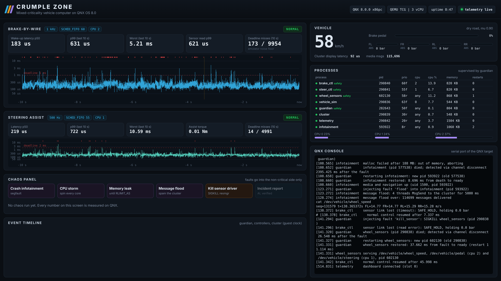
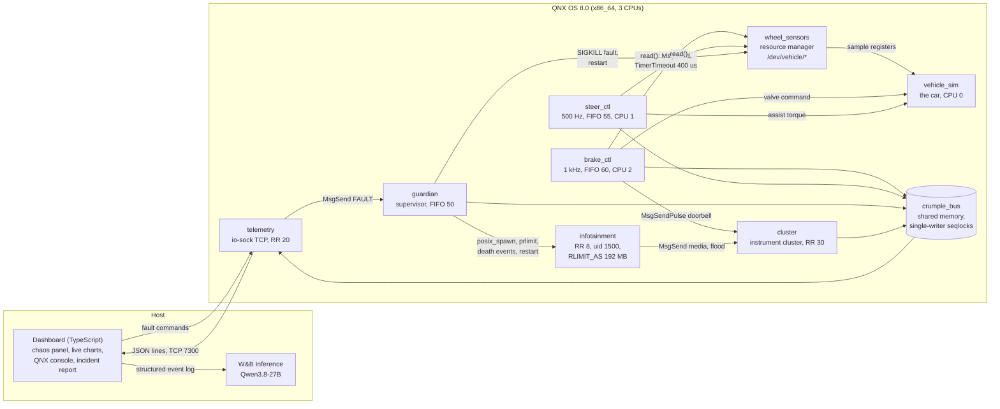

# Crumple Zone

**A crash in the infotainment system cannot touch the brakes.** Crumple Zone is a software-defined vehicle computer
on QNX OS 8.0: a 1 kHz brake-by-wire loop, a 500 Hz steering loop, a sensor driver, an instrument cluster and an
infotainment stack run as isolated QNX processes on one machine. A live chaos panel crashes, starves, leaks and floods
the infotainment side while the brake loop keeps its schedule and a guardian brings the failed process back in
milliseconds. Every number on screen is measured inside QNX, and an AI incident report turns each run into a safety
summary whose every figure is checked against the event log.

**Video:** https://youtu.be/2PXPmrBxjRM · **Devpost:** https://devpost.com/software/crumple-zone



## The problem

Carmakers are consolidating infotainment, the instrument cluster and vehicle control onto one computer to cut cost,
weight and wiring. That puts a media app, third-party plugins and a brake controller on the same silicon. A memory leak
in navigation, a crashing plugin or a runaway thread must never delay a brake command. Functional safety calls this
freedom from interference, and showing it, not just claiming it, is the hard part of every mixed-criticality design.
It is QNX's home market.

## Our solution

Crumple Zone gives the car a crumple zone in software: the non-critical side is allowed to fail, and the failure is
absorbed there.

- **Spatial isolation.** Every function is its own QNX process with its own address space. Infotainment runs as an
  unprivileged user under an address-space limit imposed from outside, with no write access to the state the
  controllers publish.
- **Temporal isolation.** The brake loop is the highest-priority SCHED_FIFO thread, pinned to its own CPU and released
  by a high-resolution timer on an absolute grid. Every call it makes into another process is bounded by a kernel
  timeout, and it never blocks on anything less critical than itself.
- **Fast, measured recovery.** A guardian learns of a death through three independent kernel paths and restarts the
  process with its original priority, CPU, credentials and limits, timestamping fault, detection, spawn and ready on
  one clock. A controller that loses its sensor driver detects it within one period, holds a safe command and
  reconnects the moment the driver is back.
- **Proof on screen.** The dashboard plots every iteration of every control loop, the event timeline and the real QNX
  console, and a kernel trace is captured for every fault.
- **An incident report an engineer can trust.** After each run, an LLM writes the safety summary: what failed, what the
  guardian did, the timing impact on each loop. Code verifies every number against the event log before it is shown.

## What happens when things go wrong

Five faults, injected live on QNX OS 8.0 (full tables, raw data and kernel traces in [results/](results/results.md)):

| Fault injected | What QNX did | Recovery |
|---|---|---|
| Infotainment crash (SIGSEGV) | Guardian notified by the process-death event 5.0 ms after the fault | Ready again 12.1 ms after the fault |
| CPU storm: every core at 100% | Brake stayed pinned on CPU 2; kernel scheduled it within 11.7 us (p50) and 63 us (p99) of becoming ready | No restart needed |
| Memory leak | `RLIMIT_AS` stopped infotainment at 188 of 192 MB; it died alone | Restarted in 7.0 ms |
| Message flood: 99,746 messages | Served at infotainment's priority; cluster display latency 486 us (480 us before the flood) | No restart needed |
| Sensor driver killed (SIGKILL) | Brake detected the loss 1.25 ms after the kill and held a safe command | Driver back 11.4 ms after the kill |

Through every fault the brake loop never left its CPU, never lost its sensor link during the infotainment faults, and
the kernel ran it within 13 to 17 us (p50) of it becoming ready.

## QNX technologies used

| QNX technology | What it does in Crumple Zone | Where |
|---|---|---|
| Neutrino message passing | Guardian protocol, fault commands, media messages to the cluster | `qnx/src/guardian.c`, `qnx/common/cz_child.c`, `qnx/src/cluster.c` |
| Pulses and high-resolution timers | 1 kHz and 500 Hz releases on an absolute grid; non-blocking doorbells | `qnx/common/cz_rt.c`, `qnx/src/brake_ctl.c` |
| Kernel timeouts (`TimerTimeout`) | Every sensor read bounded to 400 us | `bounded_read()` in `qnx/src/brake_ctl.c` |
| Resource manager framework | The sensor driver behind `/dev/vehicle/*` | `qnx/src/wheel_sensors.c` |
| SCHED_FIFO, CPU runmasks, priority inheritance | Brake owns CPU 2; requests served at the sender's priority | `qnx/common/cz_rt.c`, `qnx/src/cluster.c` |
| Process-death and pathname-space events | Guardian detection; controllers reconnect when a driver returns | `qnx/src/guardian.c`, `qnx/src/brake_ctl.c` |
| `posix_spawn` QNX extensions and `prlimit` | Restarts with the original credentials, CPU and memory limit | `spawn_child()` in `qnx/src/guardian.c` |
| Kernel event tracing | One trace per fault proves the scheduling numbers | `qnx/common/cz_rt.c`, `dashboard/src/tools/trace.ts` |
| procfs, CPU-time clocks and io-sock | Per-process CPU and memory, streamed live to the dashboard | `qnx/src/telemetry.c` |
| `mkqnximage` | An image that boots straight into the demo | `image/` |

[docs/qnx-features.md](docs/qnx-features.md) links every item to the QNX 8.0 documentation page it was built against.

## How Crumple Zone uses each QNX technology

### Neutrino message passing

The guardian owns one channel created with `_NTO_CHF_DISCONNECT` (`main()` in `qnx/src/guardian.c`). Each supervised
process connects with `ConnectAttach()` and introduces itself with `MsgSend()` (`cz_guardian_connect()` in
`qnx/common/cz_child.c`). Infotainment receives fault commands by long poll: its command thread is reply-blocked in
`MsgSend(CZ_MSG_CMD_WAIT)` until the guardian answers (`inject()`), so the untrusted process never needs a public
channel of its own.

### Pulses and high-resolution timers

Each control loop arms a one-shot high-resolution timer with `TIMER_TOLERANCE` for its next absolute release
(`cz_oneshot_pulse_timer()` and `cz_timer_arm_abs()` in `qnx/common/cz_rt.c`), so lateness is measured against the true
schedule and the loop never drifts. The brake rings the instrument cluster with `MsgSendPulse()`, which never blocks.

### Kernel timeouts

`bounded_read()` in `qnx/src/brake_ctl.c` calls `TimerTimeout(_NTO_TIMEOUT_SEND | _NTO_TIMEOUT_REPLY)` before every
sensor `read()`. A dead driver fails the read at once and a hung one times out after 400 us; either way the brake enters
its safe hold in that same period (`cz_brake_step()` in `qnx/common/control.c`).

### Resource manager framework

`qnx/src/wheel_sensors.c` registers `/dev/vehicle/wheel_speed`, `/pedal` and `/steering` with `resmgr_attach()`.
`io_read()` returns a binary sample to controllers and one line of text to anything else, so `cat
/dev/vehicle/wheel_speed` works on the QNX console. Each controller's devices have their own dispatch channel created
with `_NTO_CHF_INHERIT_RUNMASK`, so a read is served on the controller's own CPU.

### Real-time scheduling, runmasks and priority inheritance

`brake_ctl` is SCHED_FIFO 60 pinned to CPU 2 with `ThreadCtl(_NTO_TCTL_RUNMASK_GET_AND_SET_INHERIT)` (`cz_pin_cpu()`);
steering owns CPU 1 and the vehicle model CPU 0. The cluster serves brake pulses, its frame timer and infotainment's
messages on one priority-ordered channel, so a flood is processed at infotainment's priority while the flood senders
wait in SEND or REPLY: back-pressure without starving the display.

### Process-death and pathname-space events

`on_death()` in `qnx/src/guardian.c` runs on the first of three signals: a `PROCMGR_EVENT_PROCESS_DEATH` pulse from
`procmgr_event_notify_add()`, a `_PULSE_CODE_DISCONNECT` pulse on the guardian's channel, or the `waitid()` reaper.
Controllers watch `PROCMGR_EVENT_PATHSPACE` (`link_thread()` in `qnx/src/brake_ctl.c`) and reconnect the instant a
restarted driver registers its paths.

### `posix_spawn` extensions and resource limits

`spawn_child()` starts every process with `posix_spawn()` and QNX attributes for policy, priority,
`POSIX_SPAWN_EXPLICIT_CPU` and `POSIX_SPAWN_SETCRED`, then applies `prlimit()` with `RLIMIT_AS` (infotainment's 192 MB)
and `RLIMIT_CORE`. `on_ready()` computes fault-to-ready and detection-to-ready times and publishes them as events.

### Kernel event tracing

`cz_trace_mark()` inserts user events with `TraceEvent(_NTO_TRACE_INSERTUSRSTREVENT, ...)` at injection, death and
restart. `dashboard/src/tools/results.ts` runs `tracelogger` around every fault, and `dashboard/src/tools/trace.ts`
measures the brake thread's READY to RUNNING latency before and during each fault. One trace per fault is in
`results/traces/`.

### procfs, CPU-time clocks and io-sock

`qnx/src/telemetry.c` reads per-process CPU time and memory through `DCMD_PROC_INFO` and `clock_getcpuclockid()`, folds
in each loop's statistics from a single-writer shared-memory bus, and streams JSON lines over an io-sock TCP socket to
the dashboard.

### `mkqnximage`

`image/build-image.sh` drives `mkqnximage --type=qemu` with our own snippets: the binaries go into the IFS, the guardian
starts from `post_startup.sh`, and the `startup-x86` clock source is set in the definitions, so the image boots straight
into the demo.

## AI incident report

After each chaos run, `dashboard/src/server/report.ts` sends the structured event log to W&B Inference
(`Qwen/Qwen3.8-27B`, fallback `zai-org/GLM-5.3-Flash`) and asks for the report a safety engineer would write.
`dashboard/src/shared/verify.ts` then checks every number in the answer against the log; a report with an unverified
number is regenerated, and anything that still does not match is flagged on screen. In the demo run, 20 of 20 numbers
were verified.

## Architecture



## Build and run

Requirements: **QNX SDP 8.0** (baseline `com.qnx.qnx800`, `qcc` with gcc 12.2 for `x86_64`, `mkqnximage`), **QEMU
x86_64** (`qemu-system-x86`), Node.js 20+ with pnpm, and gcc and make on a Linux host.

```bash
source ~/qnx800/qnxsdp-env.sh
make image     # builds the QNX binaries with qcc and the x86_64 image with mkqnximage
make run       # boots QNX in QEMU (KVM when available) and opens the dashboard at http://127.0.0.1:8080
make test      # host unit tests, then an on-target run that injects every fault
make results   # measures every fault and captures one kernel trace each into results/
```

The image boots straight into the demo. The QNX console is on TCP 127.0.0.1:4555 (also in the dashboard), ssh on
127.0.0.1:2222. The incident report needs `OPENAI_BASE_URL`, `OPENAI_API_KEY` and `OPENAI_MODEL` in `.env` (see
`.env.example`); `make record` renders the demo video and needs `ELEVENLABS_API_KEY`.

## Repository layout

| Path | Contents |
|---|---|
| `qnx/common/` | Real-time helpers, shared-memory bus, control law, statistics, vehicle model |
| `qnx/src/` | The QNX processes, plus `czctl` (console tool) and `rtbench` (platform benchmark) |
| `image/` | `mkqnximage` snippets, image build and QEMU launch scripts |
| `dashboard/` | Dashboard, incident report and verifier, smoke test, results runner, trace analysis, recorder |
| `tests/host/` | C unit tests for the control law, statistics and vehicle model |
| `results/` | Measured results and one kernel trace per fault |
| `docs/` | QNX features used, build log, screenshots |

## License

GNU Affero General Public License v3.0, see [LICENSE](LICENSE). Nothing from the QNX SDP is included in this
repository; building requires your own QNX SDP 8.0 installation and license.
