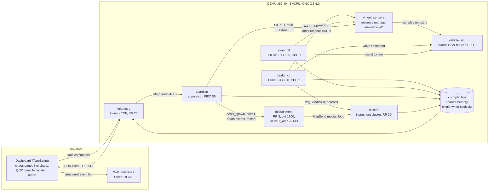

# Crumple Zone

Crumple Zone is a software-defined vehicle computer on QNX OS 8.0 that shows a crash in the infotainment system
cannot touch the brakes. A 1 kHz brake-by-wire loop, a 500 Hz steering loop, a sensor driver, an instrument
cluster and an infotainment stack run as isolated processes on one QEMU x86_64 machine, supervised by a guardian
that restarts a failed process in milliseconds. A chaos panel injects five faults into the non-critical side and
shows, from numbers measured inside QNX, that the safety loops keep running while the guardian recovers; an AI
incident report summarises each run, and code checks every number in it against the event log.

**Video:** https://youtu.be/2PXPmrBxjRM (2:38; local copy: [demo/video.mp4](demo/video.mp4))


## The problem and our solution

Carmakers are consolidating infotainment, the instrument cluster and vehicle control onto one computer. A media
app that leaks memory, a navigation plugin that crashes, or a runaway thread must never delay a brake command.
Proving that is what mixed-criticality engineering is about, and it is QNX's home market.

Crumple Zone gives the vehicle a crumple zone in software: the non-critical side is allowed to fail, and the
failure is absorbed there.

- **Spatial isolation.** Every function is its own process with its own address space. Infotainment runs as an
  unprivileged user with an address-space limit imposed from outside by the guardian, and has no write access to
  the shared state the controllers publish.
- **Temporal isolation.** The brake loop is the highest-priority SCHED_FIFO thread pinned to its own CPU, woken by
  a high-resolution timer on an absolute release grid. Every call it makes into another process is bounded by a
  kernel timeout. It never blocks on anything less critical than itself: it publishes through single-writer
  shared memory and rings the instrument cluster with asynchronous pulses.
- **Fast, measured recovery.** The guardian learns of a death through three independent kernel paths, restarts the
  process with its original priority, CPU, credentials and limits, and timestamps fault, detection, spawn and
  ready on one clock. Controllers that lose a sensor driver detect it in the next period, hold a safe command,
  and reconnect the moment the restarted driver registers its paths.
- **Evidence.** The dashboard shows each loop's every iteration, the event timeline and the real QNX console. Each
  fault is compared with an equal-length window just before it, and a kernel trace per fault separates what QNX
  decided from what the emulator added.

## QNX technologies used

| Technology | What it does here | File |
|---|---|---|
| Neutrino message passing (`ChannelCreate`, `ConnectAttach`, `MsgSend`, `MsgReceive`, `MsgReply`) | Guardian protocol (hello, ready, long-poll fault commands), infotainment to cluster media messages, telemetry to guardian fault requests | `qnx/src/guardian.c`, `qnx/common/cz_child.c`, `qnx/src/cluster.c` |
| Pulses (`MsgSendPulse`, timer pulses) | 1 kHz and 500 Hz releases, brake to cluster doorbells that never block | `qnx/common/cz_rt.c`, `qnx/src/brake_ctl.c` |
| High-resolution timers (`timer_create`, `TIMER_TOLERANCE`, `TIMER_ABSTIME`) | Releases off the 1 ms tick, on a fixed absolute grid | `cz_oneshot_pulse_timer()`, `cz_timer_arm_abs()` in `qnx/common/cz_rt.c` |
| Kernel timeouts (`TimerTimeout`) | Every sensor `read()` bounded to 400 us; a hung driver cannot stall the brake | `bounded_read()` in `qnx/src/brake_ctl.c` |
| Resource manager framework (`resmgr_attach`, `dispatch_*`, `iofunc_*`) | Sensor driver serving `/dev/vehicle/wheel_speed`, `/pedal`, `/steering` | `qnx/src/wheel_sensors.c` |
| `_NTO_CHF_INHERIT_RUNMASK` | Driver threads serve each controller on the controller's own CPU | `make_dispatch()` in `qnx/src/wheel_sensors.c` |
| Priority inheritance and priority-ordered channels | Sensor reads served at brake priority; a message flood served at infotainment priority | `qnx/src/wheel_sensors.c`, `qnx/src/cluster.c` |
| SCHED_FIFO priorities, runmasks (`ThreadCtl(_NTO_TCTL_RUNMASK_GET_AND_SET_INHERIT)`) | Brake owns CPU 2, steering CPU 1, physics CPU 0 | `cz_pin_cpu()` in `qnx/common/cz_rt.c`, plan in `qnx/common/cz.h` |
| Death notification (`procmgr_event_notify_add(PROCMGR_EVENT_PROCESS_DEATH)`, `_NTO_CHF_DISCONNECT`, `waitid`) | Guardian detects a dead process three ways, restarts on the first | `qnx/src/guardian.c` |
| Pathname-space events (`PROCMGR_EVENT_PATHSPACE`) | Controllers reconnect the instant a restarted driver registers | `link_thread()` in `qnx/src/brake_ctl.c` |
| `posix_spawn` extensions (`POSIX_SPAWN_SETCRED`, `POSIX_SPAWN_EXPLICIT_CPU`, scheduler) | Each process starts with its policy, priority, CPU and uid | `spawn_child()` in `qnx/src/guardian.c` |
| Resource limits (`prlimit`: `RLIMIT_AS`, `RLIMIT_CORE`) | Infotainment's leak kills only itself; no core dumps slow recovery | `spawn_child()` in `qnx/src/guardian.c` |
| Kernel event tracing (`tracelogger`, `traceprinter`, `TraceEvent` user events) | One trace per fault, analysed to separate scheduler latency from emulator stalls | `cz_trace_mark()` in `qnx/common/cz_rt.c`, `dashboard/src/tools/trace.ts`, `results/traces/` |
| procfs and CPU-time clocks (`DCMD_PROC_INFO`, `clock_getcpuclockid`, `ClockId`) | CPU % and memory per process, per-CPU load | `qnx/src/telemetry.c` |
| io-sock | Telemetry over TCP to the dashboard | `qnx/src/telemetry.c` |
| `mkqnximage`, buildfile snippets, `startup-x86` options | Image that boots straight into the demo | `image/build-image.sh`, `image/mkqnximage/snippets/` |

Every item was verified against the QNX 8.0 documentation first; details, doc pages and what was considered and
rejected (HAM, APS, ISRs, `ClockPeriod()` tuning) are in [docs/qnx-features.md](docs/qnx-features.md).

## Where to look, technology by technology

**Message passing.** The guardian owns one channel created with `_NTO_CHF_DISCONNECT` (`main()` in
`qnx/src/guardian.c`). Each supervised process connects with `ConnectAttach()` and says hello with `MsgSend()`
(`cz_guardian_connect()` in `qnx/common/cz_child.c`). Infotainment receives commands by long poll: its command
thread is reply-blocked in `MsgSend(CZ_MSG_CMD_WAIT)` until the guardian answers with a fault (`inject()`), so the
untrusted process needs no public channel of its own.

**Resource manager.** `qnx/src/wheel_sensors.c` registers three devices with `resmgr_attach()`. `io_read()` returns
a fixed-size binary sample to controllers and one line of text to anything else, so `cat /dev/vehicle/wheel_speed`
works on the console. Each controller's devices live on their own dispatch channel and service thread, with
`_NTO_CHF_INHERIT_RUNMASK`, so a read is a same-CPU handoff.

**Real-time scheduling.** `brake_ctl` (`qnx/src/brake_ctl.c`) is SCHED_FIFO 60, pinned to CPU 2 with
`ThreadCtl(_NTO_TCTL_RUNMASK_GET_AND_SET_INHERIT)`. Each period it arms a one-shot high-resolution timer for the
next absolute release (`cz_timer_arm_abs()`), so lateness is measured against the true schedule and the loop never
drifts. It counts iterations that ran off its CPU (`off_cpu`), which stays at zero.

**Bounded blocking.** `bounded_read()` calls `TimerTimeout(_NTO_TIMEOUT_SEND | _NTO_TIMEOUT_REPLY)` before every
`read()`. A dead driver fails the read at once; a hung one times out after 400 us; either way the loop enters
SAFE_HOLD in that same period (`cz_brake_step()` in `qnx/common/control.c`) and a helper thread reconnects when
`PROCMGR_EVENT_PATHSPACE` fires.

**Supervision.** `spawn_child()` starts each process with `posix_spawn()` and QNX attributes (policy, priority,
`POSIX_SPAWN_EXPLICIT_CPU`, `POSIX_SPAWN_SETCRED`), then `prlimit()` for `RLIMIT_AS` and `RLIMIT_CORE`. `on_death()`
runs on the first of: a `PROCMGR_EVENT_PROCESS_DEATH` pulse carrying the pid, a `_PULSE_CODE_DISCONNECT` pulse, or
the `waitid()` reaper. `on_ready()` computes fault-to-ready and detection-to-ready times and emits them as events.

**Message flood and back-pressure.** `qnx/src/cluster.c` serves brake doorbell pulses (priority 31), its 60 Hz frame
timer and infotainment's messages on one channel. The kernel queues them by priority and the server thread runs at
the priority of what it received, so the flood is processed at priority 8 while every flood sender sits blocked in
SEND or REPLY: back-pressure without starving the display.

**Tracing.** `cz_trace_mark()` inserts user string events (`_NTO_TRACE_INSERTUSRSTREVENT`) at fault injection, death
and restart. `dashboard/src/tools/results.ts` runs `tracelogger` around each fault and `dashboard/src/tools/trace.ts`
measures the brake thread's READY to RUNNING latency before and after the fault and flags waits during which the
brake CPU logged nothing at all (the emulated CPU was frozen).

**Image.** `image/build-image.sh` drives `mkqnximage --type=qemu` with an extra directory of snippets: our binaries
into the IFS (`ifs_files`), the guardian started by `post_startup.sh` (`post_start`), the `startup-x86` clock source
(`definitions`) and a hook for procnto flags (`options`, empty by default; see `docs/build-log.md`).

## Architecture



## Build and run

Requirements: **QNX SDP 8.0** (baseline `com.qnx.qnx800`, toolchain `qcc` with gcc 12.2 for `x86_64`, `mkqnximage`),
**QEMU x86_64** (`qemu-system-x86`, 8.2 used here), Node.js 20+ with pnpm, gcc and make on a Linux host.

```bash
source ~/qnx800/qnxsdp-env.sh
```

```bash
make image
```

```bash
make run
```

Then open http://127.0.0.1:8080. `make image` builds the ten target binaries (eight processes plus `czctl` and `rtbench`) with `qcc` (`qnx/Makefile`) and the
image with `mkqnximage` (`build/image/output/ifs.bin` and `disk-qemu.vmdk`). `make run` boots QEMU in the
background (`image/run-qemu.sh --bg`) and starts the dashboard. The image boots straight into the demo; the QNX
console is on TCP 127.0.0.1:4555 (also shown in the dashboard), ssh on 127.0.0.1:2222, telemetry on 7300.

```bash
make test
```

Runs the host unit tests (control law, statistics and vehicle model in C; verifier and run analysis in
TypeScript), then boots the image and injects every fault (`dashboard/src/tools/smoke.ts`).

```bash
make results
```

Measures every fault twice (untraced for the numbers, traced for one kernel trace per fault) into `results/`.
`make record` records and renders `demo/video.mp4` from a live run; it needs `ELEVENLABS_API_KEY` in `.env`. The
incident report needs `OPENAI_BASE_URL`, `OPENAI_API_KEY` and `OPENAI_MODEL` in `.env` (see `.env.example`).

**KVM or TCG.** `image/run-qemu.sh` uses KVM when `/dev/kvm` is writable, otherwise multi-threaded TCG with
`-cpu IvyBridge-IBRS` (with `-cpu max`, OpenSSL's AVX2 paths crash sshd under QEMU 8.2 TCG). Under TCG,
`scripts/host-rt.sh` pins each vCPU thread to its own host core so host scheduling noise does not pose as guest
latency. **The numbers in this repository and in the video were recorded under TCG** (the cloud build session has
no KVM).

## Measured results

Recorded with `make results` on QNX OS 8.0.0 in QEMU TCG (3 vCPUs). Full tables, raw data and the kernel traces:
[results/results.md](results/results.md).

| Fault | What the guardian measured | Brake loop during the fault |
|---|---|---|
| Crash infotainment (SIGSEGV) | detected 5.0 ms after the fault, ready again 12.1 ms after it | 2988 periods run, 45 deadlines missed (38 in the 3.0 s just before), sensor link never lost, never off CPU 2 |
| CPU storm (every core at 100%) | no restart needed | 6944 periods run, 119 deadlines missed (129 in the 7.0 s just before), sensor link never lost, never off CPU 2; CPU peak 100 / 100 / 100 % |
| Memory leak (RLIMIT_AS 192 MB) | peaked at 188 MB, died alone (SIGABRT), restarted in 7.0 ms | 8451 periods run, 157 deadlines missed (164 in the 8.5 s just before), sensor link never lost, never off CPU 2 |
| Message flood (99,746 messages) | no restart needed; cluster display latency peak 486 us (480 us just before) | 6952 periods run, 110 deadlines missed (160 in the 7.0 s just before), sensor link never lost, never off CPU 2 |
| Kill sensor driver (SIGKILL) | driver ready again 11.4 ms after the kill | brake detected the loss 1.25 ms after the kill, held a safe command for 21.0 ms, then resumed |

Across all runs the brake loop never ran off its CPU and its scheduler latency (READY to RUNNING, from the kernel
traces) stayed at p50 13 to 17 us and p99 68 to 91 us before and during the faults.

**Reading the numbers.** This is pure emulation on a shared cloud host. With no fault at all the brake loop misses
about 2.0% of its 1 ms deadlines, and a timer loop on the host itself, outside QEMU, sees 7067 us of lateness at
p99.9. Every table therefore puts the fault window next to an equal-length window just before it. In this run no
fault window had more brake misses than the noise without faults explains. The kernel traces show the scheduler
runs the brake within tens of microseconds of it becoming ready, so the lateness is in timer delivery, which the
emulator slows down. On KVM, `make test` additionally asserts zero deadline misses; that could not be run in this
session.

## Repository layout

| Path | Contents |
|---|---|
| `qnx/common/` | Shared definitions, real-time helpers, shared-memory bus, control law, statistics, vehicle model |
| `qnx/src/` | The QNX processes, `czctl` (console tool) and `rtbench` (platform benchmark) |
| `image/` | mkqnximage snippets, `build-image.sh`, `run-qemu.sh` |
| `dashboard/` | Dashboard server and UI, incident report and verifier, smoke test, results runner, trace analysis, recorder |
| `tests/host/` | C unit tests for the control law, statistics and vehicle model |
| `results/` | Measured results and one kernel trace per fault |
| `demo/` | Video, thumbnail and narration script |
| `docs/` | QNX features used, Devpost text, build log, stills |

## License

GNU Affero General Public License v3.0, see [LICENSE](LICENSE). Nothing from the QNX SDP is included in this
repository; building requires your own SDP 8.0 installation and license.
